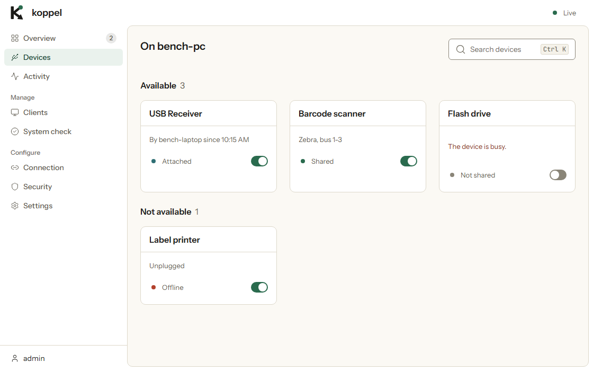
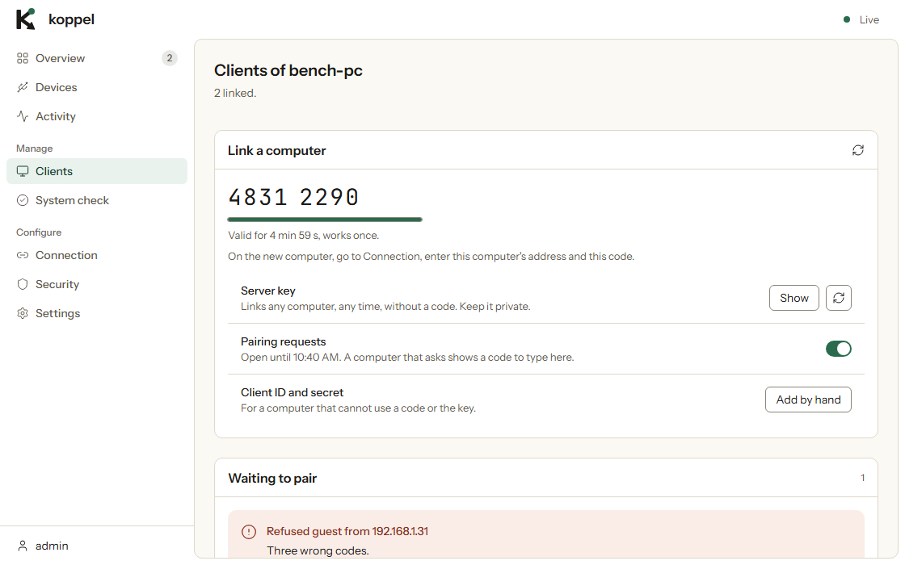
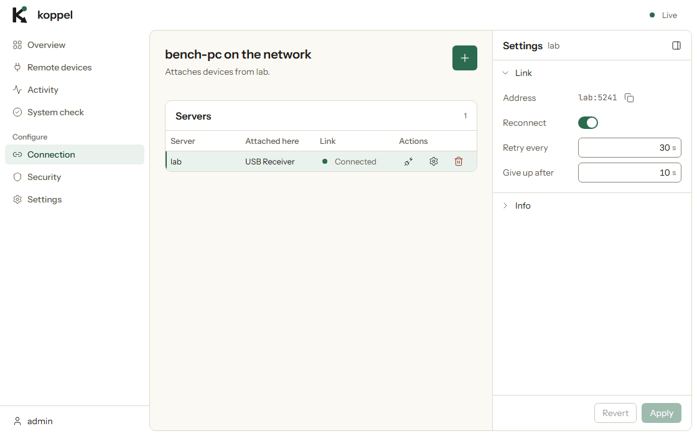

<p align="center">
  <picture>
    <source media="(prefers-color-scheme: dark)" srcset="resources/design-system/assets/Logos/koppel-mark-on-dark.svg">
    
  </picture>
</p>

<h1 align="center">Koppel</h1>

<p align="center">Share USB devices across the network. Plug a device into one machine and use it on another.</p>

Koppel speaks the standard USB/IP protocol and adds a web UI, authentication and encrypted transport
around it. A machine runs as a server (shares its devices), a client (attaches them) or both. Clients
find servers on the local network and are added with a pairing code or a server key, so nobody copies secrets
around. A client can attach devices from several servers at once.

*Koppel* is Afrikaans and Dutch for "couple" or "link". Koppel is a [Matumi](https://github.com/matumi-software) product.

New here? [Set up Koppel, step by step](docs/setup-guide.md) takes two machines from nothing to a shared device.

## What it looks like

<p align="center">
  <picture>
    <source media="(prefers-color-scheme: dark)" srcset="docs/images/devices-dark.png">
    
  </picture>
  <br>
  <sub>On the server, Devices lists what is plugged in. A switch shares a device.</sub>
</p>

<p align="center">
  <picture>
    <source media="(prefers-color-scheme: dark)" srcset="docs/images/pairing-code-dark.png">
    
  </picture>
  <br>
  <sub>On the server, Clients shows a pairing code that works once, and the server key.</sub>
</p>

<p align="center">
  <picture>
    <source media="(prefers-color-scheme: dark)" srcset="docs/images/servers-dark.png">
    
  </picture>
  <br>
  <sub>On the client, Connection lists each server and its link. Add as many as you like.</sub>
</p>

The pictures are made from the UI with example data. How to get from nothing to a shared device is in the
[step-by-step guide](docs/setup-guide.md), which also lists the known issues of this release.

## Status

Version 0.3.0 is the latest release, early: a rewrite in Rust with the same UI and features, a few MB
instead of about 100. Tried on real hardware with 0.3.0: a Linux server in Docker shares two Logitech
receivers (a keyboard and a mouse) and a flash drive to a Windows 11 client, and all three work there. Earlier
builds also went through an upgrade from 0.1.x, a 75 second network drop, and detaching and attaching by
hand. A 0.3.0 machine does not link with a 0.2.0 or a 0.1.x one (Skakel 3), so update both ends, and back up
the data folder first: there is no downgrade. Not yet run on real hardware with 0.3.0: a Linux client, a Windows
server through usbipd-win, and a Raspberry Pi (the Pi Zero build has only run under emulation). Printers are
untried, and webcams do not stream from a Linux server to a Windows client yet. The
[known issues](docs/setup-guide.md#known-issues-in-030) of 0.3.0 are in the guide. See [CHANGELOG.md](CHANGELOG.md).
Work happens on short-lived branches merged into `main` through pull requests, which use the template in
`.github/pull_request_template.md` and are reviewed by the owners in `.github/CODEOWNERS`; releases are tags on `main`.

| Platform | Server | Client |
|---|---|---|
| Linux (Docker) | Yes | Yes |
| Linux (.deb, no Docker) | Yes | Yes |
| Windows (installer) | Not yet | Yes, with usbip-win2's driver bundled |
| Windows (Docker Desktop) | Through usbipd-win, see [docs/windows.md](docs/windows.md) | Through usbip-win2, see [docs/windows.md](docs/windows.md) |

## Run it on Linux

The image is `matumisoftware/koppel` on Docker Hub, for amd64, arm64 and arm/v6. On a Raspberry Pi, the
script below treats Raspberry Pi OS as Debian; it has been tried on the 64-bit one. For a Pi Zero, the
armhf `.deb` below is the simpler way.

1. Copy [src/installer/docker/prepare-host.sh](src/installer/docker/prepare-host.sh) to the machine and
   run it once. It installs Docker from Docker's apt repository (Debian and Ubuntu) and loads the kernel's USB/IP
   modules now and at every boot:

   ```sh
   sudo bash prepare-host.sh
   ```

   If a module will not load, the script says so; on an Ubuntu cloud kernel the fix is usually
   `sudo apt-get install linux-modules-extra-$(uname -r)`.

2. Copy [src/installer/docker/docker-compose.yml](src/installer/docker/docker-compose.yml) to the machine
   and start Koppel next to it:

   ```sh
   docker compose up -d
   ```

3. Within 10 minutes, open `https://<machine>:5240`, set the password and choose the role. Koppel
   prints a one-time setup token in its log, and the first-run screen asks for it: read it with
   `docker compose logs koppel`. If the 10 minutes pass, the UI says so: run `docker compose restart`,
   read the new token and open the UI again. The browser warns about the certificate the first
   time, because it is Koppel's own; accept it to go on.

The container uses the host's network so clients can find it. It restarts after a crash, and comes
back at the next reboot even if someone stopped it by hand. The image has a health check, but plain Docker only reports an unhealthy container and does not restart it.

The compose file pins the image version (`matumisoftware/koppel:0.3.0`). To upgrade, change the tag to the new
version, then:

```sh
docker compose pull && docker compose up -d
```

Settings, the server's certificate, registered clients and the encryption keys live in the `koppel`
volume, not in the image, so an upgrade keeps them.

### Without Docker

A `.deb` package runs Koppel as a systemd service on Debian 12 and 13, Ubuntu 22.04 and later, and
Raspberry Pi OS, for amd64, arm64 and armhf. It needs no Docker and no other package. Download the package for
the machine from the [latest release](https://github.com/matumi-software/koppel/releases/latest) and
install it:

```sh
wget https://github.com/matumi-software/koppel/releases/download/v0.3.0/koppel_0.3.0_amd64.deb
sudo apt install ./koppel_0.3.0_amd64.deb
```

On 64-bit Raspberry Pi OS, take `koppel_0.3.0_arm64.deb` instead, and on 32-bit Raspberry Pi OS on any Pi,
the Zero included, `koppel_0.3.0_armhf.deb`.

The install loads the USB/IP modules now and at every boot, then starts the `koppel` service. Open
`https://<machine>:5240` within 10 minutes and set the password, with the setup token that
`sudo journalctl -u koppel` shows (after that, `sudo systemctl restart koppel` opens setup again with a new token). If a module will not load, the install says so; the fix is the same as above.

- Config and keys live in `/var/lib/koppel`. An upgrade (`sudo apt install` of a newer `.deb`) and
  `sudo apt remove koppel` keep them; `sudo apt purge koppel` deletes them.
- Settings go in `/etc/default/koppel` as environment variables, one per line, e.g. `KOPPEL_UI_ALLOW_FROM=lan`.
  Then `sudo systemctl restart koppel`.
- The service runs as root, as the container does, and restarts if it stops.

### Other Linux distributions

On a distribution that does not install a `.deb` (Fedora, Arch, openSUSE and others), take the tarball for the
machine from the same release: `koppel_0.3.0_amd64.tar.gz`, `koppel_0.3.0_arm64.tar.gz` or
`koppel_0.3.0_armhf.tar.gz`. The program is one static binary, so it needs no libraries from the system. It
needs a kernel that has the `usbip-host` and `vhci-hcd` modules, and systemd for the service.

```sh
wget https://github.com/matumi-software/koppel/releases/download/v0.3.0/koppel_0.3.0_amd64.tar.gz
tar -xzf koppel_0.3.0_amd64.tar.gz
cd koppel_0.3.0_amd64
sudo ./install.sh
```

`install.sh` does what the `.deb` does and prints the same first-run steps. Run the new tarball's `install.sh`
to upgrade; config and keys in `/var/lib/koppel` are never touched. `sudo ./uninstall.sh` removes Koppel and
keeps them, `sudo ./uninstall.sh --purge` deletes them too. Without systemd the script installs the files and
leaves the service to you.

## Run it on Windows

Download `Koppel-<version>-setup.exe` from the [latest release](https://github.com/matumi-software/koppel/releases/latest)
and run it. It installs Koppel as a Windows service, usbip-win2's signed
driver and the Visual C++ runtime. It also adds an inbound firewall rule for the Koppel program on Private and Domain networks, so a Windows server can be reached without one added by hand. Open
https://localhost:5240 afterwards, accept the browser's certificate warning and set the password within 10 minutes
(after that, pick Restart Koppel in the menu of the Koppel icon in the notification area). The UI answers on this machine only. The Koppel icon in the notification
area opens the UI, and its menu shuts Koppel down until the next boot. **Koppel** in the Start menu opens the UI
too, and starts Koppel first if it is not running. See
[docs/windows.md](docs/windows.md) for what the installer does to `%ProgramData%\Koppel` and the driver.

## Ports

| Port | What |
|---|---|
| 5240 TCP | The web UI, and everything other Koppel machines do: tokens, pairing, the device list and USB traffic. HTTPS with the server's own certificate. The UI needs the password and answers the local network only, this machine only on native Windows (`KOPPEL_UI_ALLOW_FROM`) |
| 5240 UDP | Finding servers on the local network |

Koppel needs only 5240, TCP and UDP. `KOPPEL_NETWORK_PORT` puts what other machines do on a port of its own,
and `KOPPEL_DISCOVERY_PORT` moves discovery; see [docs/ports.md](docs/ports.md). A machine that is a server can
also save its port, and limit what other machines may reach it from (this network only, or any network), under
Connection in the UI. The port applies after Koppel restarts, and `KOPPEL_NETWORK_PORT`, when set, wins; see
[docs/network-settings.md](docs/network-settings.md).

A Windows client also has a port that never leaves the machine: a gateway on 127.0.0.1:3242 for
usbip-win2's driver. The driver speaks plain USB/IP and cannot sign in, so it connects there and Koppel
carries each connection to the server over TLS on 5240. Through Docker Desktop the gateway is published on
the host as 127.0.0.1:3240 instead. See [docs/windows.md](docs/windows.md).

The browser warns about Koppel's certificate the first time, because it is Koppel's own. On a network you do not
trust, check that its SHA-256 fingerprint is the one under Clients before you accept it. If you forget the password:

```sh
docker compose run --rm koppel reset-password
```

With the Linux package, run `sudo koppel reset-password`. On Windows, from an elevated prompt, run `Koppel.exe reset-password` from `C:\Program Files\Matumi (Pty) Ltd\Koppel`. Then open
the UI within 10 minutes and set a new password (on Linux and in Docker, with the new setup token from the log).

## Help test Koppel

Koppel is young, and every report helps; [#42](https://github.com/matumi-software/koppel/issues/42) lists
what is most wanted. The most useful things to send:

- **Which devices work.** Tried a device, whether it worked or not? Open a
  [device report](https://github.com/matumi-software/koppel/issues/new?template=device-report.yml) with its
  VID:PID (Koppel's device list shows it) and what runs on each end.
- **Bugs.** Open a [bug report](https://github.com/matumi-software/koppel/issues/new?template=bug-report.yml)
  with the steps and the logs: `docker logs <container>` in Docker, `sudo journalctl -u koppel` for the Linux
  package, or Event Viewer (Windows Logs, Application, source Koppel) on Windows. The Activity page in the UI
  shows what happened too.
- **Ideas and questions.** Bring them to [Discussions](https://github.com/matumi-software/koppel/discussions).

Security problems go privately through [SECURITY.md](SECURITY.md), not into an issue.

## Develop

See the commands in [CLAUDE.md](CLAUDE.md) and the design in
[docs/architecture.md](docs/architecture.md). To build the Windows installer, the Linux packages or the
image yourself, see "Building and releasing" in [docs/building.md](docs/building.md); to run your own build on another machine, see
"Running on another machine" in [docs/installers.md](docs/installers.md).

## License

Copyright (C) 2026 Matumi (Pty) Ltd. Koppel is free software under the GNU General Public License,
version 3 or (at your option) any later version (GPL-3.0-or-later), see [LICENSE](LICENSE).
Releases up to and including 0.1.0 were published under the MIT licence and stay under it.

Koppel's transport between machines is [Skakel](https://github.com/matumi-software/skakel) (MIT), a
set of Rust crates; its notice is in `THIRD-PARTY-NOTICES.txt` with the other crates'.

The Windows installer bundles usbip-win2 (BSD-2-Clause); its notices ship as `THIRD-PARTY-NOTICES.txt`,
which is installed with Koppel. The setup window is Matumi's shared installer window (from the Heartwood repository), which
the setup.exe carries; it only draws the installer and is not part of Koppel.
